<div align="center">
  
</div>

<br />

```yaml
# ~/.config/ishaan.yml
name: Ishaan Singh
role: engineering student
location: New Delhi, India
interests: [systems, applied AI, embedded and hardware]
habit: rebuilding things from scratch to see how they work
recently: shipped EzPC at ETHGlobal Mumbai 2026
```

### `$ ls ~/projects`

<table>
  <tr>
    <td width="50%" valign="top">
      <h4><a href="https://github.com/beastb728/cyros">cyros/</a></h4>
      Adaptive Linux environment for handheld gaming devices, built with Buildroot. Telemetry, workload-aware tuning and predictive power management to stretch performance and battery life.
      <br /><br />
      <code>Linux</code> <code>Buildroot</code> <code>Shell</code>
    </td>
    <td width="50%" valign="top">
      <h4><a href="https://github.com/beastb728/FogLink">FogLink/</a></h4>
      Collision warnings for fog on Indian expressways. When a vehicle ahead brakes hard, drivers behind hear a spoken alert in about 300 ms. No accounts, no location history.
      <br /><br />
      <code>Kotlin</code> <code>Go</code> <code>WebSockets</code> <code>OpenStreetMap</code>
    </td>
  </tr>
  <tr>
    <td width="50%" valign="top">
      <h4><a href="https://github.com/beastb728/bittorrent-from-scratch">bittorrent-from-scratch/</a></h4>
      A BitTorrent client written end to end: torrent parsing, peer discovery, handshakes, piece downloading and SHA-1 verification.
      <br /><br />
      <code>Python</code> <code>Networking</code> <code>Protocols</code>
    </td>
    <td width="50%" valign="top">
      <h4><a href="https://github.com/beastb728/EzPC">EzPC/</a></h4>
      An AI agent that plans a gaming PC and pays for its own data with x402 on Hedera, limited to the allowance you approve. Built at ETHGlobal Mumbai 2026.
      <br /><br />
      <code>JavaScript</code> <code>AI agents</code> <code>Hedera</code> <code>x402</code>
    </td>
  </tr>
</table>

**Also in the directory:**
[urban-heat-intelligence-platform](https://github.com/beastb728/urban-heat-intelligence-platform) ·
[rag-debugger](https://github.com/beastb728/rag-debugger) ·
[rag-memory](https://github.com/beastb728/rag-memory) ·
[emergent-language](https://github.com/beastb728/emergent-language)

### `$ echo $STACK`

<p>
  
</p>

### `$ git log --graph`

<picture>
  <source media="(prefers-color-scheme: dark)" srcset="https://raw.githubusercontent.com/beastb728/beastb728/output/github-contribution-grid-snake-dark.svg" />
  
</picture>

```console
ishaan@github:~$ exit
logout — thanks for stopping by.
```
